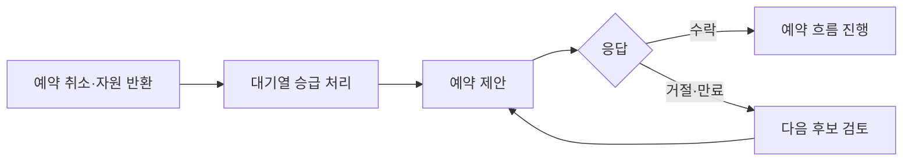
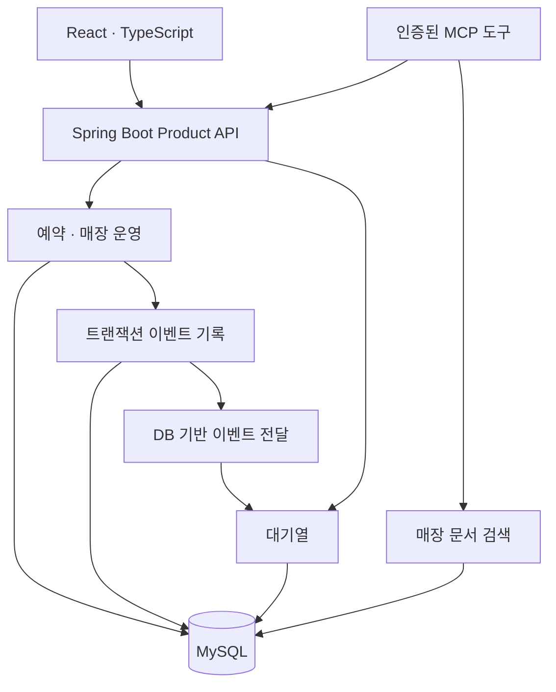

<div align="center">

# SlotQ

### 동시 예약과 대기열을 처리하는 매장 예약·운영 시스템

</div>

## 개요

SlotQ는 매장의 예약, 수용량, 대기열, 운영 정책을 관리하는 시스템입니다. 예약이 동시에 발생하거나 이벤트가 중복 전달되고, 처리 도중 장애가 발생하는 상황에서도 데이터 정합성과 복구 가능성을 유지하는 데 중점을 둡니다.

예약·대기열을 먼저 구현하고 검증한 뒤, 기존 Product API를 권한 범위 안에서 호출하고 매장 안내 문서를 검색하는 AI 구성 요소를 추가했습니다. 각 기능은 테스트와 실험 결과를 기준으로 구현 범위와 한계를 구분합니다.

## 주요 기능

| 영역 | 구현 내용 |
| --- | --- |
| 예약 | 예약 가능 시간 조회, HOLD 생성·확정·취소, 체크인·완료·노쇼 처리 |
| 동시성·멱등성 | 동일 자원 경합 제어, 중복 HOLD 요청 처리, 결과 불명 상황의 재조회 |
| 대기열 | 대기 등록·취소, 빈자리 발생 시 제안 생성, 수락·거절·만료 후 다음 순서 처리 |
| 매장 운영 | 매장·자원·운영 정책 관리, 예약과 대기열 조회, 권한 범위에 따른 접근 |
| 이벤트·복구 | 트랜잭션 이벤트 기록, 중복 처리 방지, 재시도, 장애 복구 및 운영 관측 |
| AI 접근·검색 | 인증된 MCP 도구 호출, 접근 범위가 제한된 문서 검색, 모델 선택과 제한된 실행 관리 |

AI 구성 요소 중 **MCP와 지식 검색은 M6에서 완료**했습니다. M7에서는 **Model Router와 제한된 Agent Runtime**, Customer·Owner/Manager·Ops의 공통 실행 경로와 합성 데이터의 실제 모델 통합 검증을 완료했습니다. 현재 지원 범위에는 durable workflow가 불필요하다고 판정했으며, [M7 최종 통합 검증](docs/experiments/m7-closure.md)에 종료 근거와 제한사항을 기록했습니다.

## 핵심 설계와 검증

### 1. 동시 예약과 데이터 정합성

같은 `Table × Slot`에 마지막 자원 하나가 남았을 때 여러 HOLD 요청이 동시에 들어와도 중복 배정이 발생하지 않도록 제어합니다.

초기 실험에서 수용량 초과를 재현한 뒤 낙관적 락과 비관적 락을 비교했습니다. 현재 구현은 경합 대상인 Slot과 Reservation 행에 필요한 범위만 비관적 락을 적용합니다. 예약 상태 전이와 수용량 검증은 MySQL 트랜잭션 안에서 처리합니다.

- [락 전략 비교와 측정](docs/experiments/concurrency-strategy-comparison.md)
- [ADR-0006: 예약 정합성 락 선택](docs/adr/0006-use-targeted-pessimistic-locks-for-reservation-consistency.md)

### 2. 이벤트 기반 대기열

예약 취소 등으로 자원이 비면 대기 조건에 맞는 후보에게 예약 제안을 생성합니다. 수락하면 기존 예약 흐름으로 연결하고, 거절하거나 기한이 지나면 다음 후보를 처리합니다.



이벤트 중복 전달, 재시도, 수락·만료 경합에서도 기존 수용량과 예약 상태 규칙을 유지하도록 구현했습니다. 대기 순서, 제안 상태, 예약 확정은 각각 별개의 비즈니스 상태로 다룹니다.

- [이벤트 전달 구조](docs/architecture/event-delivery.md)
- [대기열 승급 설계](docs/architecture/waitlist-promotion.md)

### 3. DB 기반 전달과 Kafka 비교

예약 변경과 이벤트 기록은 동일한 MySQL 트랜잭션으로 묶고, **DB 기반 전달을 기본 방식**으로 사용합니다.

M5에서는 DB 기반 전달과 Kafka 전달을 동일한 업무 시나리오로 **5개 구성 × 3회, 총 15회** 비교했습니다. 정합성·복구 검증과 운영 비용을 함께 평가한 결과, 현재 기본 방식은 DB 기반 전달로 유지하기로 했습니다.

Kafka 구현은 실제 브로커, 독립 소비자, 장애 및 수동 전환을 검증하는 **선택적 실험 구성**으로 남겨두었습니다. 자동 전환이나 상시 운영 대체 경로로 채택한 것은 아닙니다.

- [비교 실험과 한계](docs/experiments/m5-transport/README.md)
- [ADR-0008: 전달 방식 결정](docs/adr/0008-m5-event-transport-and-runtime-status.md)
- [이벤트 운영·복구 절차](docs/runbooks/event-operations.md)

### 4. AI 접근 통제와 지식 검색

M6에서는 MCP를 통해 예약 관련 Product API와 지식 검색 기능을 제한된 권한으로 호출할 수 있도록 구성했습니다. 도구 목록 조회, 직접 호출, 인증 주체와 매장 범위, 입력 검증 및 호출 제한을 서버에서 확인합니다.

매장 안내 문서는 원문 출처·버전·공개 범위를 보존하며 검색합니다. 예약 상태나 수용량처럼 수시로 바뀌는 사실은 검색 문서가 아닌 **Product API 응답을 기준**으로 합니다.

검색 방식은 어휘 기반 검색과 로컬 임베딩을 실제 비교했고, 현재 기본값은 어휘 기반 검색입니다. 외부 모델에 실제 고객 데이터를 전송하는 구성을 완료했다고 주장하지 않습니다.

- [M6 통합 검증](docs/experiments/m6-closure/README.md)
- [M6 접근·지식 구조](docs/architecture/m6-access-knowledge.md)

### 5. 모델 선택과 실행 경계

M7에서는 실제 생성 모델 두 개를 합성 데이터로 비교하고, 보안·데이터 공개 조건·기능·품질 기준을 충족한 후보만 선택하는 Model Router를 구현했습니다. 초기 72회 비교에 이어 별도 96회 보정 실험에서 세 업무의 합성 데이터 조건에 적격한 후보를 확보했습니다. 실제 실행에서도 현재 권한·데이터 공개 조건·예산을 다시 확인합니다.

또한 서버 내부에서 사용하는 **프로세스 로컬 Agent Runtime**을 구현했습니다. 실행 단계·시간·비용·동시 실행 수를 제한하고, 도구 실행 권한과 원래 요청 주체의 승인을 확인합니다. 모델 출력은 실행 권한으로 취급하지 않습니다.

Owner·Manager의 매장 운영 관측 조회도 기존 Product API를 호출하는 읽기 전용 MCP 도구로 연결했습니다. 예약 조회와 별도의 위임 권한을 사용하며, 조회 결과의 지연·누락·잘림 의미를 유지합니다.

세 업무 흐름은 같은 Runtime과 실제 MCP/Product/Knowledge 연결을 사용합니다. HOLD에는 원래 요청 주체의 명시적 승인이 필요하며, 예약 사실과 문서 안내, 운영 관측의 누락·지연·잘림을 구분합니다. #155에서 민감정보 없는 합성 데이터의 실제 모델 응답을 검토·재계산했고, #156은 현재 bounded process-local profile에서 durable workflow가 불필요하다고 판정했습니다. 자동 도구 실행 루프나 재시작 이후 Run·예산 복구는 제공하지 않습니다.

- [모델 비교 결과](docs/experiments/m7-model-router.md)
- [Router 보정 실험](docs/experiments/m7-router-corrective.md)
- [세 업무 흐름 통합 검증](docs/experiments/m7-representative-flows.md)
- [M7 최종 통합 검증과 제한사항](docs/experiments/m7-closure.md)
- [Agent Runtime 결정](docs/adr/0011-m7-process-local-agent-runtime.md)
- [M7 아키텍처와 후속 범위](docs/architecture/m7-model-router-agent-runtime.md)

## 아키텍처

예약·대기열의 중심은 **Spring Boot와 MySQL을 사용하는 모듈형 모놀리스**입니다. 데이터와 트랜잭션의 소유권을 불필요하게 여러 서비스로 나누지 않습니다.



Model Router와 Agent Runtime은 서버 내부 구성 요소이며, 제한된 세 업무 흐름을 위 Product API와 MCP 경계에 연결합니다. 외부 모델의 실제 호출 검증에는 합성 데이터만 사용합니다.

## 기술 구성

| 영역 | 기술 |
| --- | --- |
| 백엔드 | Java 25, Spring Boot, Spring MVC, Spring Data JPA |
| 프론트엔드 | React, TypeScript, Vite |
| 데이터베이스 | MySQL 8.4, Flyway |
| 테스트 | JUnit, Testcontainers, Vitest |
| 이벤트 전달 | MySQL 기반 전달(기본), Kafka(선택적 실험) |
| 운영 관측 | Micrometer, Prometheus, Grafana, Tempo |
| AI | MCP, 지식 검색, Gemini 모델 비교, Model Router, Agent Runtime |
| 로컬 환경 | Gradle Wrapper, npm, Docker |

Redis·Kubernetes와 같은 추가 인프라는 현재 필수 구성 요소가 아닙니다.

## 로컬 검증

**백엔드** — JDK 25 필요

```bash
cd backend
./gradlew test
./gradlew clean build
```

Windows PowerShell에서는 `./gradlew` 대신 `.\gradlew.bat`를 사용합니다.

**프론트엔드** — Node.js 24 LTS, npm 11 필요

```bash
cd frontend
npm ci
npm run typecheck
npm test
npm run build
```

로컬 환경 준비와 실행 명령은 [CONTRIBUTING.md](CONTRIBUTING.md), 프론트엔드 환경 변수와 API 연결 방법은 [frontend/README.md](frontend/README.md)를 참고하세요. 일부 통합 테스트와 실험은 Docker 및 별도 실행 설정을 필요로 합니다.

## 개발 현황

| 단계 | 상태 | 주요 결과 |
| --- | --- | --- |
| M0~M2 | 완료 | 프로젝트 기반, 예약 API, 상태 전이와 동시성 제어 |
| M3~M4 | 완료 | 이벤트 전달 기반, 대기 등록·승급과 화면 연결 |
| M5 | 완료 | 운영 관측, 장애 복구, DB/Kafka 비교 |
| M6 | 완료 | MCP 접근 통제, 지식 관리·검색과 통합 검증 |
| M7 | 완료 | Model Router·제한된 Agent Runtime·세 업무 흐름, fresh 실제 모델 비교·통합 검증과 durable 불필요 판정 |
| M8 | 예정 | 평가 체계와 운영 준비 기준 |

M7의 Model Router와 Runtime 구현은 각각 [PR #159](https://github.com/krestar/slotq/pull/159), [PR #160](https://github.com/krestar/slotq/pull/160)에 반영되어 있습니다. Milestone별 작업 범위와 선행 관계는 [Roadmap](docs/roadmap.md)에서 관리합니다.

## 설계·실험 문서

- [도메인 모델](docs/architecture/domain-model.md)
- [아키텍처 결정 기록](docs/adr/README.md)
- [M5 전달 방식 비교](docs/experiments/m5-transport/README.md)
- [M6 통합 검증](docs/experiments/m6-closure/README.md)
- [M7 모델 비교](docs/experiments/m7-model-router.md)
- [전체 개발 계획](docs/roadmap.md)
